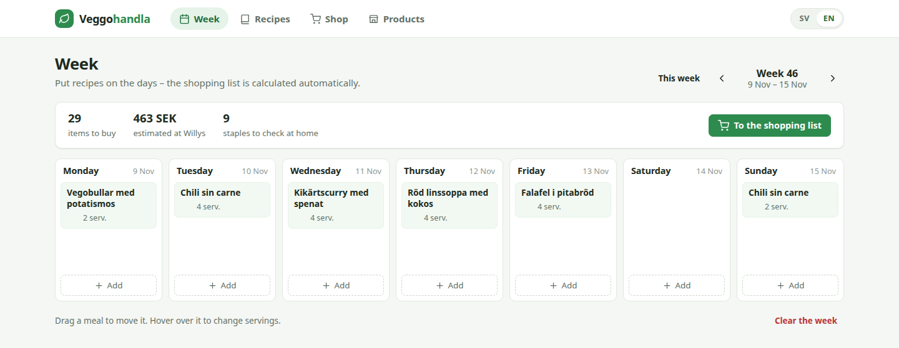
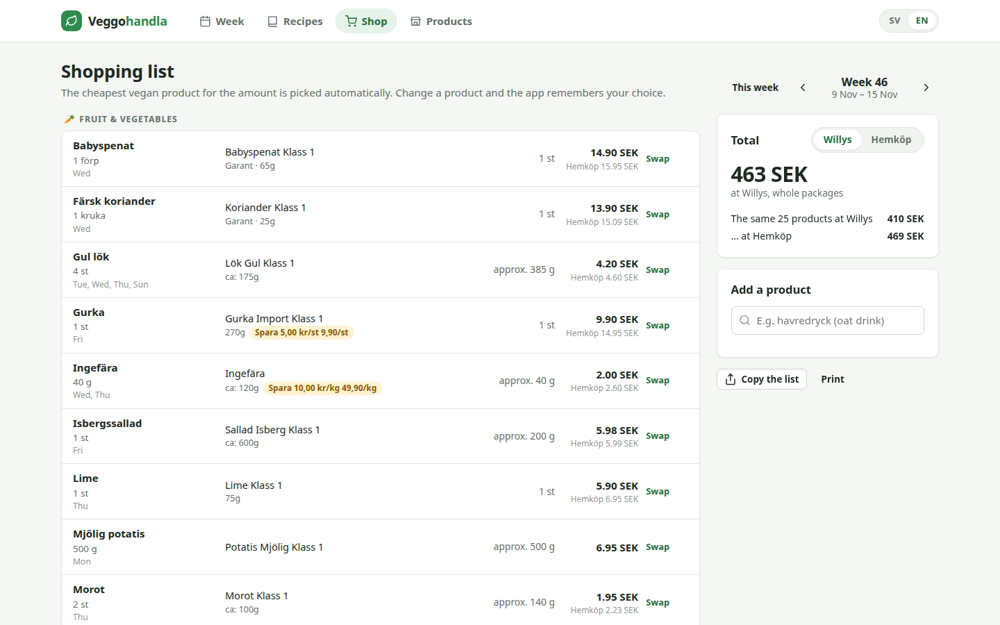
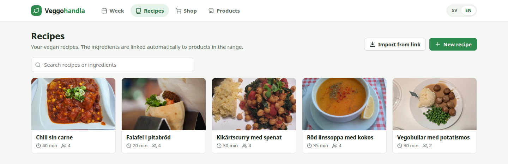

# 🌱 Veggohandla

Plan the week's vegan meals and get a ready shopping list with real products and
prices from Willys and Hemköp, two Swedish supermarket chains.





<sub>Recipe photos from Wikimedia Commons:
[Benreis](https://commons.wikimedia.org/wiki/File:Chilli_sine_carne_Zur_Tanne_Harsdorf.jpg) (CC BY-SA 4.0),
[Israel_photo_gallery](https://commons.wikimedia.org/wiki/File:Falafel_in_a_pita.jpg) (CC BY-SA 2.0),
[Kari Sullivan](https://commons.wikimedia.org/wiki/File:Spinach-Chickpea_Curry_(3117324894).jpg) (CC BY 2.0),
[E4024](https://commons.wikimedia.org/wiki/File:Red_lentil_soup_from_Turkey.jpg) (CC BY-SA 4.0),
[Andy Li](https://commons.wikimedia.org/wiki/File:Plant_balls_served_with_mashed_potatoes,_peas,_cream_sauce_-_IKEA_Southampton_2025-12-29.jpg) (CC0).
Store product images are hidden in the screenshot.</sub>

- **Week** – put recipes on the days, change servings, drag between days.
- **Recipes** – write ingredients as plain text (`500 g mjölig potatis`, `0,5 förp vegobullar`)
  or import from ICA, Köket, Arla and others with a link. While you type you see which
  product each line becomes.
- **Shop** – the list is calculated automatically. Each ingredient becomes the cheapest vegan
  product for exactly the amount you need (750 g of vegobullar → one 900 g bag instead of
  three small ones). Promotions are included. If you want a particular brand, press *Swap* –
  the choice is remembered. The same products are compared between Willys and Hemköp.
- **Products** – a local index of the chains' food products. Only vegan products are shown:
  labelled vegan by the chain, or with an ingredient list free of animal ingredients.

Everything runs locally on your computer. No account, no cloud service.

The interface is available in Swedish and English. The **SV / EN** switch in the top right
changes language, and your browser's language is used at first. Recipe, ingredient and
product names are always Swedish, because the stores are Swedish. The method of a recipe can
be written in any language, but ingredient lines need the Swedish ingredient names and units
(`dl`, `msk`, `förp` …) to be recognised.

## Getting started

Requires [uv](https://docs.astral.sh/uv/) (installs the right Python automatically).

```bash
git clone https://github.com/fsson/veggohandla.git && cd veggohandla
uv run manage.py serve
```

Open <http://127.0.0.1:8000>. The first time, the database is created in `data/` with 111
ingredients and 5 vegan recipes with photos. As long as `serve` runs, the product range is fetched
automatically every morning (see below). To keep the app running without leaving your
computer on, a Raspberry Pi works well – see [Running on a Raspberry Pi](#running-on-a-raspberry-pi).

The recipe photos are downloaded from [Wikimedia Commons](https://commons.wikimedia.org) when the
database is created. They are openly licensed, and the photographer and licence are shown on each
recipe page.

### Fetching the product range

In their robots.txt, Willys and Hemköp ask for at most one request per 10 seconds and only
between 04:00 and 08:45 UTC (05:00–09:45 Swedish winter time, 06:00–10:45 summer time). The
app follows that:

- `serve` updates the range automatically every morning within the window: prices and
  promotions (~20 minutes) and checking new products. You can also press *Update now*
  under **Products**, or run `uv run manage.py index`, within the window.
- To decide what is vegan, the app reads each product's ingredient list, one product per
  request. That is ~4,000 products, but only ~1,600 requests fit in a morning. The range is
  therefore fully ready only after **three days of runs**. This only applies the first time –
  afterwards only new products are checked, which takes a few minutes.
- You don't have to wait three days: products your recipes use are checked first, so the
  shopping list works after the first morning. The rest of the range fills in over time and
  shows up under **Products** once it has been checked.
- When the time window closes the run pauses. Nothing is lost – the next morning it
  continues where it stopped.
- Updating only happens while the app is running, so an always-on computer such as a
  Raspberry Pi is the most convenient.

## Running on a Raspberry Pi

A Raspberry Pi 4 (any memory size) is plenty. The app then runs around the clock, updates
the product range every morning and can be reached from computers and phones on your home
network.

1. **Install Raspberry Pi OS (64-bit).** Use [Raspberry Pi Imager](https://www.raspberrypi.com/software/),
   choose *Raspberry Pi OS Lite (64-bit)*, and in the settings set a hostname
   (e.g. `veggohandla`), a user, Wi-Fi and *Enable SSH*. The 64-bit version is required.
2. **Log in and install git:**

   ```bash
   ssh <user>@veggohandla.local
   sudo apt update && sudo apt install -y git
   ```

3. **Get the app and install it as a service:**

   ```bash
   git clone https://github.com/fsson/veggohandla.git && cd veggohandla
   ./deploy/install.sh
   ```

   The script installs uv, Python and the dependencies, and sets the app up as a systemd
   service that starts automatically (and restarts itself if something goes wrong). It
   takes a few minutes the first time.
4. **Open** <http://veggohandla.local:8000> from a computer or phone on the same network
   (or `http://<the-pi's-ip-address>:8000`).

After that it looks after itself: the range is updated every morning, and the app starts
again after a power cut.

| What | Command |
|---|---|
| Update to the latest version | `cd ~/veggohandla && git pull && ./deploy/install.sh` |
| View the log | `journalctl -u veggohandla -f` |
| Restart / stop | `sudo systemctl restart veggohandla` / `sudo systemctl stop veggohandla` |
| Another port | `PORT=8080 ./deploy/install.sh` |
| Back up | copy the directory `~/veggohandla/data/` |

**Reaching the app when you're not home:** To access the app remotely you can set up your own VPN on the Pi,
for example [PiVPN](https://pivpn.io) with WireGuard.

## How products are chosen

Each ingredient has a rule for which products count as it, e.g.
`krossade tomat -chili -vitlök` (all words must be in the product name, `-word` excludes).
The rules live in `core/seed_data.py`. Among the matching products, the one that is cheapest
for the amount is picked, counting whole packages, loose weight per kg and promotions like
"2 för 46 kr" (only if you buy at least 2).

New ingredients you type in a recipe are created automatically and match products with the
same name.

## The vegan check

The chains' vegan labelling is incomplete, so each product's ingredient list is read once:

- labelled vegan → included
- ingredient list without animal words (mjölk, ägg, vassle, honung, gelatin, karmin, D3 …) → included
- an animal word found → never included
- no ingredient list → included only if it is unprocessed fruit or vegetables

"Kan innehålla spår av mjölk" (may contain traces of milk) doesn't count, since it is about
allergy and not about contents. Under **Products** each product shows why it counts as vegan.

## Data and backups

Everything (database and images) lives in `data/`. Copy that directory to make a backup.
The directory is ignored by git.

## About the store data

Willys and Hemköp (Axfood) have no official API. The app uses the same open JSON calls as
their websites – only when you index, at the pace and during the hours their robots.txt
specifies, and the result is stored locally. Willys' terms allow use of the content *only for
personal use*: run the app yourself, for yourself. It may stop working at any time and the
chains' terms apply. Recipes, planning and the shopping list keep working with the prices
fetched last.

## Development

```bash
VEGGOHANDLA_DEBUG=1 uv run manage.py runserver   # development server with error pages and reloading
uv run pytest            # 140+ tests: units, merging, vegan check, product choice, views, translation
```

See [docs/ARCHITECTURE.md](docs/ARCHITECTURE.md) for how it fits together.

### Translations

Swedish is the source language: the Swedish texts in the code and templates are the keys, and
`locale/en/` holds the English translation. When you change a text:

```bash
uv run manage.py makemessages -l en -i .venv -i data -i docs --no-obsolete --no-location
# translate new entries in locale/en/LC_MESSAGES/django.po; for changed texts, rewrite the
# translation and remove both "#, fuzzy" and the "#| msgid …" line holding the old text
uv run manage.py compilemessages -l en     # builds django.mo, which is committed
```

A test (`core/tests/test_i18n.py`) fails if a text is untranslated, if `django.mo` is stale,
or if Swedish interface text leaks through on the English pages.
